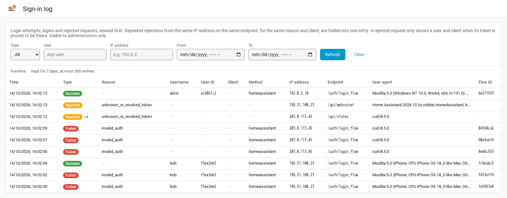

# Login Detail

Home Assistant integration that tells you which username was used in a failed
login attempt - and when, and from which IP address.

[](https://github.com/fuglphoenix/ha-login-detail/actions/workflows/ci.yml)
[](https://github.com/fuglphoenix/ha-login-detail/actions/workflows/validate.yml)
[](https://hacs.xyz/docs/faq/custom_repositories)



When a login fails, Home Assistant logs the IP address and the URL - never the
username that was tried. A successful login is not logged at all. The first
part is a known, open issue in core:
[home-assistant/core#148110](https://github.com/home-assistant/core/issues/148110).

Login Detail fills that gap. It fires an event for every failed and every
successful login and for every request rejected for invalid authentication,
keeps a short history in six sensors, and shows it all in an admin-only
**Sign-in log** panel. Passwords and TOTP codes are never read, logged or
forwarded, and tokens are never stored.

> [!WARNING]
> This integration **monkeypatches private Home Assistant core API**:
> `HassLoginFlow.async_step_init`, `LoginFlow.async_step_mfa`,
> `AuthManagerFlowManager.async_finish_flow` and `process_wrong_login`. Core can change these at any
> time. After a Home Assistant upgrade the integration may silently stop
> reporting - no error, nothing breaks, logins keep working, you just stop
> getting events. All patched code is wrapped so that a failure can never
> break a login. Do the
> [post-upgrade check](docs/upgrading.md#after-a-home-assistant-upgrade) after
> every upgrade.

## Requirements

- Home Assistant **2026.10.0** or newer. The integration has only been tested
  against Home Assistant **2026.10.1**.
- No external Python packages.

## Installation

### HACS (custom repository)

1. In HACS, open the menu (⋮) → **Custom repositories**.
2. Add `https://github.com/fuglphoenix/ha-login-detail` with type
   **Integration**.
3. Find **Login Detail** in HACS and install it.

### Manual

Copy `custom_components/login_detail/` from this repository into
`config/custom_components/` on your Home Assistant installation.

### Then

1. Restart Home Assistant.
2. Go to **Settings → Devices & services → Add integration → Login Detail**.
   The dialog is a confirmation. Retention and the side panel are set later
   under **Configure** on the integration (see [Sign-in log](#sign-in-log)).

Do **not** add `login_detail:` to `configuration.yaml`. If an older setup has
the line, it is imported into a config entry automatically on the first
startup, after which the line can be removed.

### Upgrading to 0.8.0

0.8.0 makes the sensor names, units and attribute keys English. An existing
installation keeps its entity IDs, but **templates, automations and cards
that read a sensor attribute must use the new keys**, and the IP address
sensor needs a one-time unit fix under **Developer tools → Statistics**. See
[Upgrading to 0.8.0](docs/upgrading.md#upgrading-to-080) for the full table
of old and new keys.

## Events and entities

Three events, with username, IP address, endpoint and reason, for use in
automations - fields in [Events](docs/events.md):

- `login_detail_failed` - a failed login attempt.
- `login_detail_succeeded` - a successful login.
- `login_detail_request_rejected` - a request rejected for invalid
  authentication outside the login flow, for example an expired token on
  `/api/mcp`. Rejections on REST views need `ip_ban_enabled`, see
  [Known limitations](docs/known-limitations.md).

Six sensors, created automatically - no YAML, no helpers. Attributes in
[Entities](docs/entities.md):

| Entity ID (new installation) | Entity ID (installed before 0.8.0) | Shows |
|---|---|---|
| `sensor.login_latest_event` | `sensor.login_seneste_haendelse` | Latest login event |
| `sensor.login_ok_24h` | `sensor.login_ok_24t` | Successful logins, last 24 hours |
| `sensor.login_failed_24h` | `sensor.login_mislykkede_24t` | Failed logins and rejected requests, last 24 hours |
| `sensor.login_ip_addresses_24h` | `sensor.login_ip_adresser_24t` | Unique IP addresses, last 24 hours |
| `sensor.login_history` | `sensor.login_historik` | Stored events |
| `sensor.login_active_sessions` | `sensor.login_aktive_sessioner` | Active refresh tokens per user |

## Sign-in log

An admin-only panel, **Sign-in log**, in the sidebar shows every recorded
event as one row, newest first: time, type, reason, username, user ID, login
method, client, IP address, endpoint, user agent and flow ID. Repeated
rejections from the same IP address on the same endpoint, for the same
reason, user and client, are one row with a count. The
table can be filtered by type, user, IP address (prefix, so `192.0.2.`
matches the range) and time span.

The panel is a proof of concept for a sign-in log in core
([architecture#1346](https://github.com/home-assistant/architecture/discussions/1346))
and is built the way core would build it: the panel only talks to an
admin-only websocket command (see [Websocket API](docs/events.md#websocket-api)).
Non-admin users do not see the panel.

**Options** (Settings → Devices & services → Login Detail → Configure):

| Option | Default | Range |
|---|---|---|
| Maximum number of entries | 500 | 50-5000 |
| Keep entries for (days) | 7 | 1-365 |
| Show the Sign-in log panel | on | |
| Also store usernames that do not exist | off | |

The options can be changed at any time, also on an existing installation;
saving reloads the integration, so a change applies without a restart. An
installation from before 0.9.0 reads the new option as off.

An entry is deleted when either limit is reached. Expired entries are removed
hourly, also when nothing new is logged.

By default, the username of a failed login is only kept if a user has it.
Turn on **Also store usernames that do not exist** to see what a brute force
attempt tries: the name is then kept as typed (cut to 64 characters), and the
row is marked "no such user" (`known_user: false`, no user ID).

> [!CAUTION]
> With this option on, **a password typed into the username field is stored
> in plain text** - in the events, the Home Assistant log, the Sign-in log,
> the sensor history, the recorder database and every backup that contains
> them. Turning the option off again does not remove what was stored. Only
> turn it on if you accept that, and tell the people who log in.

## Automation example

Send a notification for every failed login attempt:

```yaml
automation:
  - alias: "Notify on failed login"
    triggers:
      - trigger: event
        event_type: login_detail_failed
    actions:
      - action: notify.notify
        data:
          title: "Failed Home Assistant login"
          message: >-
            {{ trigger.event.data.username }} from
            {{ trigger.event.data.ip_address }}
            ({{ trigger.event.data.reason }})
```

Example notification:

```text
Failed Home Assistant login
alice from 203.0.113.7 (invalid_mfa_code)
```

## Privacy

This integration stores usernames, user IDs, IP addresses and user agents in
plain text - in the events, the log, `.storage/login_detail_history`, the
sensor attributes and therefore the recorder database and backups - and looks
up every IP address with reverse DNS. With the option **Also store usernames
that do not exist**, that includes whatever was typed into the username
field, possibly a password. If you run Home Assistant for other
people, tell them. Details in [Privacy](docs/privacy.md).

## Removal

1. **Settings → Devices & services → Login Detail → Delete.** The monkeypatch
   is taken off immediately and the sensors disappear, without a restart.
2. Delete `config/custom_components/login_detail/` (or uninstall it in HACS).
3. Restart Home Assistant.

The history file `.storage/login_detail_history` is kept, so a re-install
picks up where it left off. Delete it as well if you want the stored
usernames and IP addresses gone.

## Documentation

- [Events, log lines and websocket API](docs/events.md), including
  [rejected requests](docs/events.md#rejected-requests)
- [Entities and attributes](docs/entities.md)
- [Upgrading](docs/upgrading.md), including the
  [check after a Home Assistant upgrade](docs/upgrading.md#after-a-home-assistant-upgrade)
- [Privacy](docs/privacy.md)
- [Known limitations](docs/known-limitations.md)
- [Contributing and issues](docs/contributing.md)
- [Changelog](CHANGELOG.md)

## Maintainer

Owned and maintained by [@fuglphoenix](https://github.com/fuglphoenix).
This is a personal project, provided as is under the MIT license; there is
no support agreement. Report bugs and questions in
[issues](https://github.com/fuglphoenix/ha-login-detail/issues).

## License

[MIT](LICENSE)
